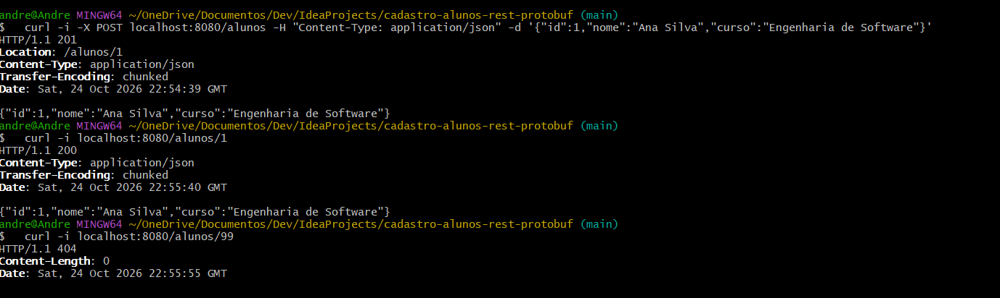
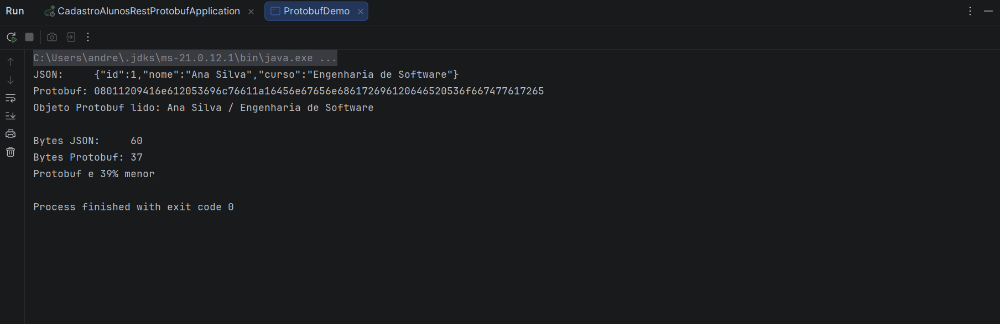
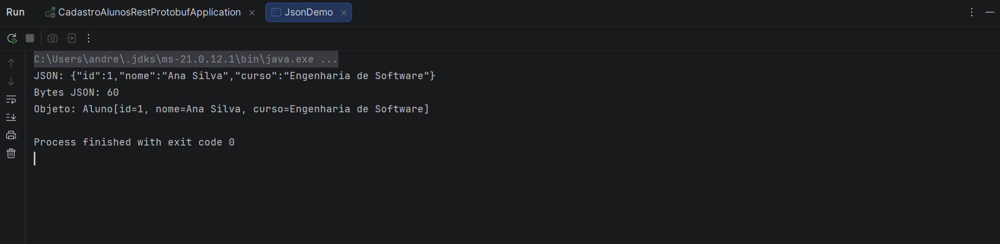

# Cadastro de Alunos — JSON, REST e Protobuf

Atividade prática de **Sistemas Distribuídos** (IFG). O projeto implementa, em Java, um serviço de cadastro de alunos que expõe dados por uma API REST e compara a representação em **JSON** com a representação binária em **Protocol Buffers (Protobuf)**.

## Tecnologias

- Java 21
- Spring Boot 4.1.1 (Spring Web MVC) e Maven
- Jackson 3 (`tools.jackson`), para JSON
- Protocol Buffers 4.28.3, para a serialização binária

## Estrutura do projeto

```
src/main
├── java/br/edu/ifg/cadastroalunosrestprotobuf
│   ├── Aluno.java                 # record com id, nome e curso
│   ├── AlunoController.java       # API REST (GET e POST)
│   ├── JsonDemo.java              # serialização/desserialização JSON
│   ├── ProtobufDemo.java          # Protobuf e comparação de tamanho
│   └── CadastroAlunosRestProtobufApplication.java
└── proto/aluno.proto              # contrato Protobuf
```

## Pré-requisitos

- JDK 21
- Maven (ou o Maven Wrapper `mvnw`, já incluído no projeto)
- Git
- Acesso à internet na primeira compilação, para baixar o `protoc`

## Como executar

1. Clone o repositório e entre na pasta:
   ```bash
   git clone https://github.com/ANDRELUIS07/cadastro_alunos_rest_protobuf.git
   cd cadastro_alunos_rest_protobuf
   ```
2. Gere as classes do Protobuf: `mvn compile`
    - Se o IDE não enxergar `AlunoProto`, marque `target/generated-sources/protobuf/java` como **Generated Sources Root**.
3. Rode `JsonDemo` e `ProtobufDemo` (método `main`) para ver os formatos.
4. Suba a API em `http://localhost:8080`, pelo IDE (`CadastroAlunosRestProtobufApplication`) ou com:
   ```bash
   mvn spring-boot:run
   ```

## Parte 1 — JSON

O `JsonDemo` cria um `Aluno`, converte em JSON (**serialização**) e converte o texto de volta em objeto (**desserialização**).

Saída esperada:

```
JSON: {"id":1,"nome":"Ana Silva","curso":"Engenharia de Software"}
Bytes JSON: 60
Objeto: Aluno[id=1, nome=Ana Silva, curso=Engenharia de Software]
```

## Parte 2 — API REST

| Método | Endpoint | Descrição | Status |
|---|---|---|---|
| POST | `/alunos` | Cadastra um aluno (corpo em JSON) | `201 Created` |
| GET | `/alunos/{id}` | Busca um aluno pelo id | `200 OK` ou `404 Not Found` |

Os alunos ficam em memória (`ConcurrentHashMap`) e são perdidos ao encerrar a aplicação.

Testes com curl:

```bash
curl -i -X POST localhost:8080/alunos -H "Content-Type: application/json" \
  -d '{"id":1,"nome":"Ana Silva","curso":"Engenharia de Software"}'
curl -i localhost:8080/alunos/1     # 200 OK
curl -i localhost:8080/alunos/99    # 404 Not Found
```

O Spring converte automaticamente JSON em `Aluno` na requisição e `Aluno` em JSON na resposta, usando o Jackson.

## Parte 3 — Protobuf

O contrato fica em `src/main/proto/aluno.proto`:

```proto
message Aluno {
  int32 id = 1;
  string nome = 2;
  string curso = 3;
}
```

O plugin `protobuf-maven-plugin` gera a classe Java `AlunoProto.Aluno` a partir desse arquivo durante o `mvn compile`. O `ProtobufDemo` serializa o mesmo aluno com `toByteArray()`, desserializa com `parseFrom()` e compara o tamanho com o JSON.

Saída esperada:

```
JSON:     {"id":1,"nome":"Ana Silva","curso":"Engenharia de Software"}
Protobuf: 08011209416e612053696c76611a16456e67656e686172696120646520536f667477617265
Objeto Protobuf lido: Ana Silva / Engenharia de Software

Bytes JSON:     60
Bytes Protobuf: 37
Protobuf e 39% menor
```

### Por que o Protobuf é menor

O binário não envia o nome dos campos, só o número de cada um. Lendo o hexadecimal:

- `08 01`: campo 1 (`id`), valor 1
- `12 09 ...`: campo 2 (`nome`), 9 bytes de texto ("Ana Silva")
- `1a 16 ...`: campo 3 (`curso`), 22 bytes de texto ("Engenharia de Software")

## Comparação JSON × Protobuf

| Critério | JSON | Protobuf |
|---|---|---|
| Representação | Texto | Binário |
| Legibilidade | Alta | Baixa (exige ferramenta) |
| Tamanho neste exemplo | 60 bytes | 37 bytes |
| Esquema | Opcional | Obrigatório (`.proto`) |
| Nome dos campos na mensagem | Sim | Não, só o número |
| Uso típico | APIs REST públicas | gRPC e comunicação interna |

### Quando usar cada formato em uma API REST

- **JSON é preferível:** APIs públicas, consumo por navegador e front-end, depuração simples e clientes variados sem acesso ao `.proto`.
- **Protobuf é preferível:** comunicação interna entre microsserviços, grande volume de mensagens, economia de banda e contratos rígidos e versionados.

## Observações

- A API não usa banco de dados: é um exemplo didático.
- Os endpoints REST trocam apenas JSON. O Protobuf é demonstrado no `ProtobufDemo`.

  ## Evidências

  ### API REST (curl)
  

  ### JSON
  

  ### Comparação JSON × Protobuf
  

## Autor

André Luís Cardoso Rezende Pimenta — Engenharia de Software, Instituto Federal de Goiás (IFG). Atividade da disciplina de Sistemas Distribuídos.